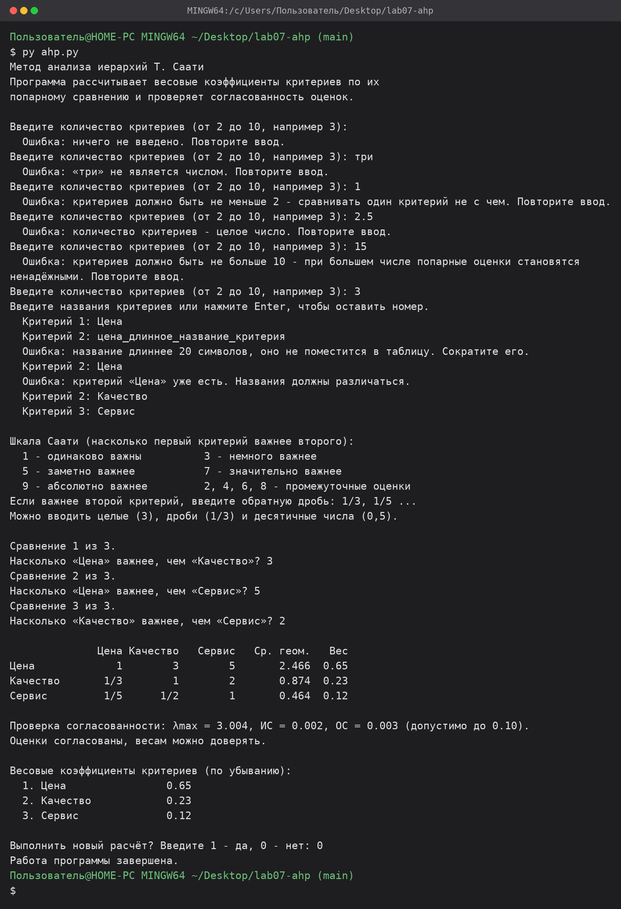
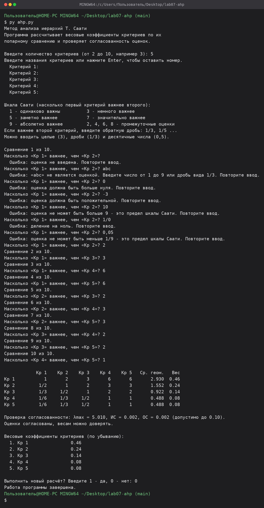
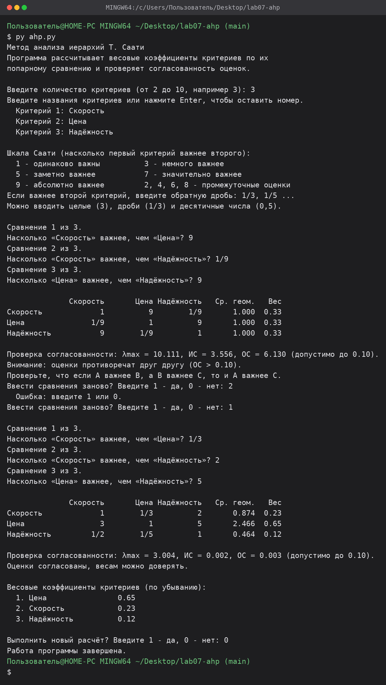

# Метод анализа иерархий Т. Саати

## Исполнитель

Сурков Владимир Андреевич  
Группа Фт-250008

## Формулировка задания

Написать программу, реализующую метод анализа иерархий Томаса Саати для одного уровня.

- **Входные данные:** количество критериев, данные попарного сравнения критериев (запрашиваются попарно).
- **Выходные данные:** весовые коэффициенты критериев в виде `0.00`.

Требования к качеству программы:

- код содержит комментарии к функциям и основным блокам, объясняющие, *зачем* сделано то или иное решение;
- качественный диалог с пользователем и обработка ошибок ввода для минимизации отказов при неправильном вводе.

Программу требуется протестировать для 3 и 5 критериев с отражением обеспечения надёжности.

## Метод расчёта

1. Пользователь сравнивает каждую пару критериев по шкале Саати. Программа запрашивает только оценки выше главной диагонали матрицы: элементы диагонали равны 1, а симметричные элементы вычисляются как обратные величины, `a[j][i] = 1 / a[i][j]`.
2. Для каждой строки матрицы вычисляется среднее геометрическое её элементов.
3. Весовой коэффициент критерия равен среднему геометрическому его строки, делённому на сумму средних геометрических всех строк.
4. Проверяется согласованность оценок: вычисляются λmax, индекс согласованности `ИС = (λmax − n) / (n − 1)` и отношение согласованности `ОС = ИС / СИ`, где СИ — случайный индекс Саати для данного числа критериев. При `ОС > 0,10` оценки противоречат друг другу, и программа предлагает ввести их заново.

## Среда разработки

Язык программирования: Python 3.13 (подходит Python 3.7 и новее).  
Среда разработки: Visual Studio Code (подойдёт любая среда для Python — PyCharm, IDLE, Visual Studio).  
Дополнительные библиотеки не требуются.

Проект состоит из одного файла — **`ahp.py`**, его и нужно открывать.

## Как запустить

```bash
git clone <ссылка на репозиторий>
cd <папка репозитория>
py ahp.py
```

На Windows программа запускается командой `py ahp.py` (или `python ahp.py`, если Python добавлен в PATH). В Visual Studio Code: открыть папку проекта, открыть `ahp.py` и нажать **Run → Run Without Debugging** (`Ctrl+F5`).

## Инструкция по работе

1. Введите количество критериев — целое число от 2 до 10.
2. Введите названия критериев, например «Цена», «Качество». Чтобы оставить номер («Кр 1», «Кр 2»…), нажмите Enter.
3. Программа покажет шкалу Саати и по очереди спросит, насколько один критерий важнее другого:

   | Оценка | Значение |
   | --- | --- |
   | 1 | критерии одинаково важны |
   | 3 | первый немного важнее |
   | 5 | первый заметно важнее |
   | 7 | первый значительно важнее |
   | 9 | первый абсолютно важнее |
   | 2, 4, 6, 8 | промежуточные оценки |
   | 1/3, 1/5 … | важнее второй критерий |

   Оценку можно ввести целым числом (`3`), дробью (`1/3`) или десятичным числом (`0,5` или `0.5`).
4. Программа выведет матрицу попарного сравнения, средние геометрические, результат проверки согласованности и весовые коэффициенты по убыванию.
5. Если оценки несогласованы, программа предложит ввести сравнения заново.
6. На вопрос «Выполнить новый расчёт?» ответьте `1` — да или `0` — нет. Прервать работу можно в любой момент сочетанием клавиш `Ctrl+C`.

## Надёжность работы программы

При любой ошибке ввода программа объясняет её причину и повторяет вопрос. Уже введённые данные при этом сохраняются.

| Ввод | Пример | Сообщение программы |
| --- | --- | --- |
| Пустой ввод | — | ничего не введено / оценка не введена |
| Не число | `три`, `abc` | «три» не является числом |
| Дробное количество критериев | `2.5` | количество критериев — целое число |
| Критериев меньше 2 или больше 10 | `1`, `15` | критериев должно быть не меньше 2 / не больше 10 |
| Слишком длинное название | более 20 символов | название не поместится в таблицу |
| Повтор названия | `Цена` дважды | названия должны различаться |
| Ноль или отрицательная оценка | `0`, `-3` | оценка должна быть больше нуля / положительной |
| Оценка вне шкалы Саати | `10`, `0,05` | оценка не может быть больше 9 / меньше 1/9 |
| Деление на ноль | `1/0` | деление на ноль |
| Несогласованные оценки | ОС > 0,10 | оценки противоречат друг другу, предлагается повторный ввод |
| Неверный ответ на вопрос | `2` | введите 1 или 0 |
| Прерывание | `Ctrl+C`, `Ctrl+Z` | работа программы прервана пользователем |

## Результаты тестирования

### Тест 1 — 3 критерия, ошибки ввода количества и названий

При вводе количества критериев введены пустая строка, `три`, `1`, `2.5` и `15`. При вводе названий — слишком длинное название и повтор названия «Цена». На каждую ошибку программа выводит пояснение. Оценки согласованы (ОС = 0,003), веса: Цена — 0.65, Качество — 0.23, Сервис — 0.12.



### Тест 2 — 5 критериев, ошибки ввода оценок

Названия оставлены по умолчанию. При первом сравнении введены пустая строка, `abc`, `0`, `-3`, `10`, `1/0` и `0,05` — все значения отклонены с пояснением. Затем введены 10 оценок, матрица согласована (ОС = 0,002), веса: 0.46, 0.24, 0.14, 0.08, 0.08.



### Тест 3 — 3 критерия, несогласованные оценки и повторный ввод

Введены противоречивые оценки: «Скорость» абсолютно важнее «Цены», «Цена» абсолютно важнее «Надёжности», но «Надёжность» абсолютно важнее «Скорости». Программа обнаруживает несогласованность (ОС = 6,130 > 0,10) и предлагает ввести сравнения заново. После неверного ответа `2` и ответа `1` введены согласованные оценки (ОС = 0,003), веса: Цена — 0.65, Скорость — 0.23, Надёжность — 0.12.


